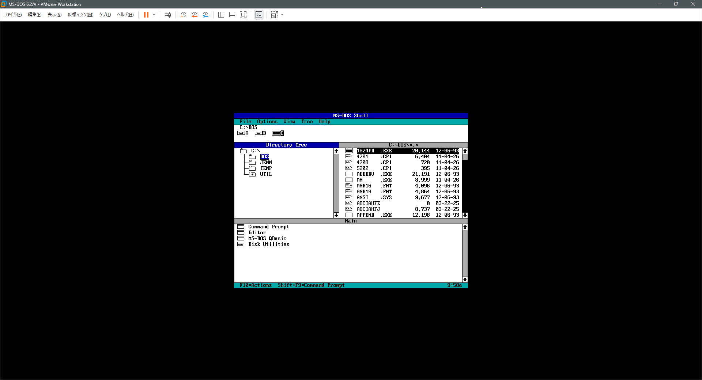
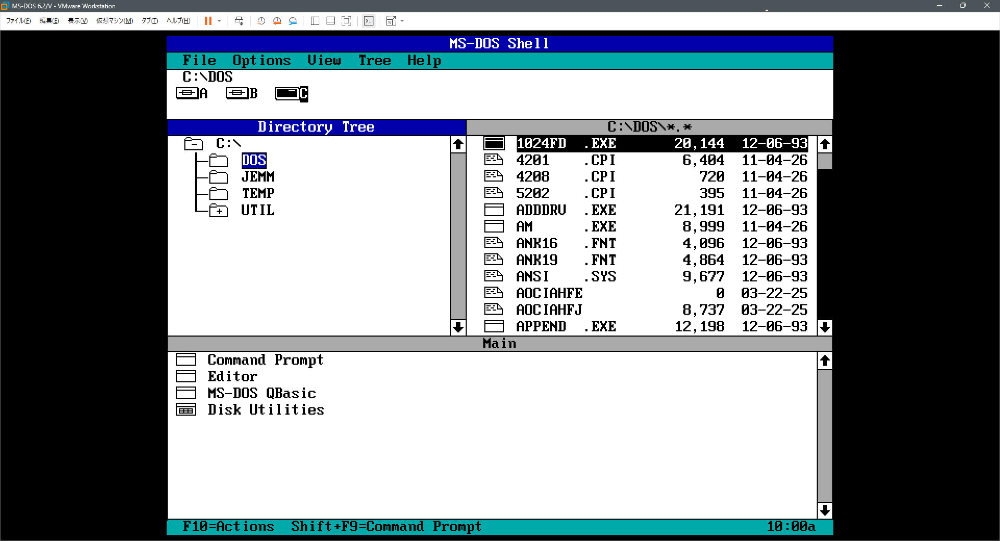
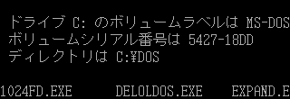

# SVGA2X

**VMware 上の DOS（DOS/V）画面を、2倍・3倍の解像度で表示する常駐プログラム**

[English README](README.md)

VMware の DOS 画面は 640x480 なので、フル HD などの高解像度のモニターでは小さく表示されます。
VMware の「ゲストをストレッチ」で拡大すると、補間で輪郭がにじみます。

SVGA2X は DOS に常駐して、画面を 1280x960（2倍）または 1920x1440（3倍）の解像度で表示し直します。
1ドットを 2×2・3×3 ドットにそのまま広げるので、にじみません。ホスト側に追加のソフトは要りません。

## 表示の比較

VMware のウインドウ全体（1920x1040、MS-DOS Shell）:

**SVGA2X なし**（画面 640x480）



**SVGA2X あり**（画面 1280x960）



DOS/V の日本語画面の一部を、実際のドット数のまま載せています（MS-DOS 6.2/V）。

**SVGA2X なし**（画面 640x475 の一部）



**SVGA2X あり**（画面 1280x950 の一部）


「あり」の画像は、「なし」の画像の各ドットを 2×2 にしたものと全画素一致します。

## 特徴

- 日本語 DOS/V の画面（VGA 640x480・16色）を2倍・3倍で表示（DOS/V の 475 ライン画面は 1280x950。
  JDISP.SYS のハードウェアスクロールの有無どちらでも可）
- 英語 DOS などの 80桁テキスト画面（80x25、80x43、80x50）も2倍・3倍で表示（80x25 は 1440x800）
- 対応しない表示モード（ゲームの 320x200、256色、VESA など）に切り替わると自動で元の表示に戻り、
  対応する表示モードに戻れば再開
- リアルモード（メモリマネージャなし）でも、メモリマネージャ（MS EMM386、JemmEx）の下でも動く
- 常駐サイズは約20KB。`/U` で解除できる

## 動作条件

ホスト側:

- VMware Workstation / Player（仮想 SVGA II アダプタ、PCI 15AD:0405）。同じデバイスを模している
  VirtualBox の VMSVGA や QEMU の `-vga vmware` でも動く可能性がありますが、未確認です。実機では動きません

ゲスト側（DOS）:

- 386 以上（VMware では常に満たす）、DOS 3.3 以上（動作確認は MS-DOS 6.2/V のみ）
- メモリマネージャ（V86 モード）の下で使う場合: メモリマネージャが、画面メモリへの `INT 15h AH=87h` 転送を許すこと
  （MS EMM386 と JemmEx は既定で許す。JemmEx に `NOCHECK` を付けると不可）

## 使い方

### 起動と引数

```
SVGA2X          状態を表示する（常駐しているか、倍率、今の表示）
SVGA2X /S2      常駐する（2倍、1280x960）
SVGA2X /S3      常駐する（3倍、1920x1440。ホストの画面にその大きさが必要）
SVGA2X /S2 /Rn  常駐し、n ティックごとに更新する（n = 1..9、既定 1 = 毎秒18.2回）
SVGA2X /U       常駐を解除する
SVGA2X /?       使い方を表示する
```

引数なしでは常駐しません。常駐させるときは `/S2` か `/S3` を付けます（`/Rn` はそれと一緒に使います）。
`/Rn` で間引くのは画面に変化がないときだけで、文字の表示やカーソルの移動があると次のティックで描き直します
（操作中は毎秒18.2回）。

コマンドラインから実行するか、`AUTOEXEC.BAT` などのバッチファイルに書いて実行します。表示ドライバが
有効になった後（DOS/V なら `JDISP.SYS` と `CHEV JP` の後）に実行してください。

VMware の「ゲストをストレッチ」はオフのままにします。ウィンドウは2倍で 1280x950/960（テキスト画面は
1440x800）になります。ウィンドウがゲスト画面より大きい場合、VMware は中央に表示します。

### ホストの画面に収める

ドット単位でくっきり表示されるのは、VMware が等倍で表示しているときだけです。

- ホストの画面が十分に大きければ、**全画面表示**（Ctrl+Alt+Enter）がいちばんきれいです
  （1920x1080 のモニターで2倍なら、1280x950 が等倍で中央に表示されます）。
- 1080p のモニターで**ウィンドウ表示**にすると、メニュー・ツールバー・タブ・ステータスバーの分で
  縦が約930ラインしかなく、950/960ラインの画面は下が欠けます。「表示」→「カスタマイズ」で
  ツールバーやタブ、ステータスバーを隠すと縦が空きます。
- **「ゲストをストレッチ」をオン**にすると全体が収まりますが、VMware が補間で拡大縮小するため
  （1080p のウィンドウなら約97.5%に縮小）、輪郭がわずかににじみます（測定では、本来3色の画面の
  約3%の画素が中間の灰色になっていました）。全体が見えることを優先するなら使えますが、
  くっきりとは言えません。
- 3倍（1920x1440）には、2560x1440 以上のホスト画面が必要です。

常駐する前に、VM がその解像度を許すか（`SVGA_REG_MAX_WIDTH/HEIGHT` と画面メモリの量）を確かめます。
`.vmx` で表示が制限されている場合は、理由を表示して常駐しません。VMware が `svga.maxWidth`・`svga.maxHeight` を
適用するのは `svga.autodetect = "FALSE"` もあるときだけです（既定の自動検出では、`svga.maxWidth = "640"` が
あっても 2360x1773 まで使えます）。その場合は、これらを削除するか値を大きくしてください。`svga.vramSize` が
約5MB（2倍）・約11MB（3倍）より小さい場合も足りません。

## ソースからのビルド

ソースを修正した場合や、自分で SVGA2X.COM を作りたい場合の手順です。[NASM](https://www.nasm.us/) 2.x または 3.x で:

```
nasm -f bin -o SVGA2X.COM src/svga2x.asm
```

または `build.bat`（Windows）/ `make`。

## 動作確認

| 環境 | 結果 |
|---|---|
| VMware Workstation 26.0.1、MS-DOS 6.2/V、HIMEM のみ | OK |
| 同、MS EMM386 4.95 | OK（INT 15h AH=87h 経由） |
| 同、JemmEx 5.86（`I=TEST SPLIT NOINVLPG`） | OK（INT 15h AH=87h 経由） |

アイドル時の VM のホスト CPU 使用率（1コア=100%）: SVGA2X なし 3.4%、あり 約8〜11%（`/R2` なら 5〜6%）。3倍でもほぼ同じです。
テストの記録は [docs/TESTING.md](docs/TESTING.md)、仕組みは [docs/TECHNICAL.md](docs/TECHNICAL.md) を参照してください。

## 制限・既知の問題

- VMware の SVGA II のレジスタを直接操作するため、VMware 以外では未確認です（「動作条件」を参照）。
- V86 モードでは、画面全体がスクロールするときの CPU 負荷が高い（画面の1ライン（走査線）ごとに
  `INT 15h` を呼ぶため）。JemmEx の JLM（ring 0 で動く拡張モジュール）から画面メモリへ直接書けば
  速くできる見込みですが、未実装です。
- INT 10h を通さずポートで直接 DAC を書き換えるプログラムでは、次のモード設定まで色が違うことが
  あります。
- テキストモード: 点滅属性の文字は点滅させずに表示します。512文字フォントはフォントマップ A だけを
  使います。INT 10h（AH=11h）を通さずポートで直接読み込まれたフォントは、次のモード設定で反映
  されます。40桁モードは2倍にしません。
- Windows 3.x: Windows が起動すると、SVGA2X は2倍表示をやめて休止します（Windows は通常の
  640x480 で表示され、終了後の DOS も等倍のままです。Windows は自分で解像度を変えられます）。
  MS EMM386 の下では、Windows を起動・終了した後に画面メモリへ転送すると VM が停止する
  （トリプルフォルト）ことがあったためです。2倍に戻すには `SVGA2X /U` の後に `SVGA2X /S2` を
  実行します（自己責任でお願いします）。

## 作者・ライセンス

作者: Kenji Morimoto <github@morimoto.ne.jp>

MIT。[LICENSE](LICENSE) を参照してください。
