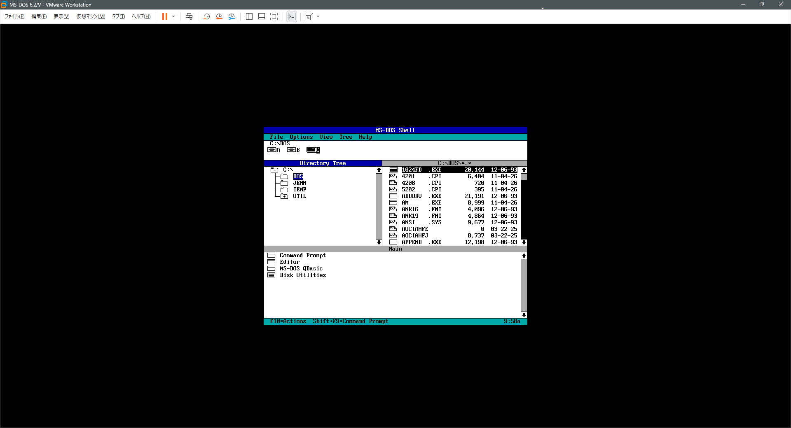
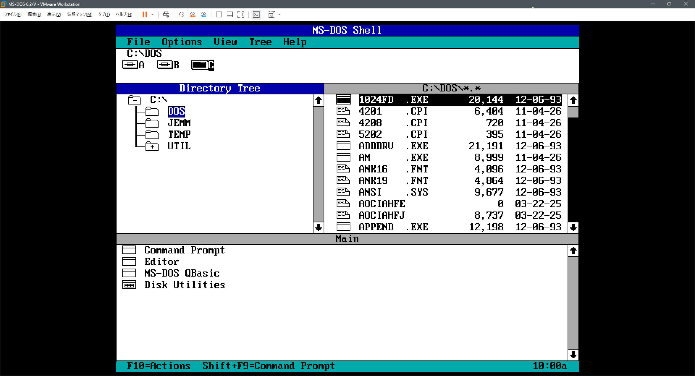
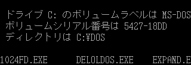

# SVGA2X

**Show DOS (DOS/V) screens in VMware at 2x / 3x resolution — a tiny TSR, no host tools needed.**

[日本語版 README](README.ja.md)

A DOS guest in VMware runs at 640x480, which looks small on high-resolution monitors such as
Full HD. VMware's "Stretch guest" option enlarges it with interpolation, which softens the edges.

SVGA2X stays resident in DOS and re-displays the screen at 1280x960 (2x) or 1920x1440 (3x). Each
pixel simply becomes a 2x2 or 3x3 block, so nothing is blurred. Nothing needs to be installed on
the host.

## Before / after

The whole VMware window (1920x1040, MS-DOS Shell):

**Without SVGA2X** (640x480)



**With SVGA2X** (1280x960)



Part of a Japanese DOS/V screen, shown at its real pixel size (MS-DOS 6.2/V):

**Without SVGA2X** (640x475)



**With SVGA2X** (1280x950)


The "with" image is pixel-for-pixel the "without" image with every pixel turned into a 2x2 block.

## Features

- Japanese DOS/V screens (VGA 640x480, 16 colours) at 2x / 3x (DOS/V's 475-line screen → 1280x950;
  with or without JDISP.SYS hardware scrolling)
- 80-column text screens of English DOS etc. (80x25, 80x43, 80x50) at 2x / 3x as well (80x25 → 1440x800)
- Other display modes (320x200 games, 256 colours, VESA, ...) automatically get the normal display
  back; SVGA2X resumes when a supported mode returns
- Works in real mode (no memory manager) and under memory managers (MS EMM386, JemmEx)
- About 20 KB resident; can be removed with `/U`

## Requirements

Host:

- VMware Workstation / Player (virtual SVGA II adapter, PCI 15AD:0405). VirtualBox's VMSVGA and
  QEMU's `-vga vmware` emulate the same device and may work, but are untested. Not for real hardware

Guest (DOS):

- 386 or later (always true in VMware), DOS 3.3+ (tested with MS-DOS 6.2/V only)
- Under a memory manager (V86 mode): the memory manager must allow `INT 15h AH=87h` copies to the framebuffer
  (MS EMM386 and JemmEx do by default; JemmEx with `NOCHECK` does not)

## Usage

### Running and options

```
SVGA2X          show the status (resident or not, scale, what is shown now)
SVGA2X /S2      stay resident, 2x (1280x960)
SVGA2X /S3      stay resident, 3x (1920x1440; needs a host screen of that size)
SVGA2X /S2 /Rn  stay resident, update every n timer ticks (n = 1..9, default 1 = 18.2 times/s)
SVGA2X /U       remove from memory
SVGA2X /?       help
```

Without options SVGA2X does not stay resident; use `/S2` or `/S3` (`/Rn` goes together with one of them).

Run it from the command line or from a batch file such as `AUTOEXEC.BAT`, after the display driver
is active (e.g. after DOS/V's `JDISP.SYS` and `CHEV JP`).

Leave VMware's "Stretch guest" off; at 2x the window becomes 1280x950/960 (1440x800 for text
screens). If the window is larger than the guest screen, VMware centres it.

### Fitting the screen on the host

The output is only pixel-sharp when VMware shows it 1:1:

- **Full screen** (Ctrl+Alt+Enter) is the best choice when the host screen is large enough
  (2x on a 1920x1080 monitor: the 1280x950 image is shown 1:1 and centred).
- In a **window** on a 1080p monitor the menu, toolbar, tabs and status bar leave only about
  930 lines, so the bottom of a 950/960-line image is cut off. Hide the toolbar/tabs/status bar
  (View > Customize) to make room.
- **"Stretch guest" on** makes everything fit, but VMware then scales the image (e.g. to about
  97.5 % in a 1080p window) with interpolation, so edges get slightly soft (measured: about 3 % of
  the pixels in intermediate greys instead of 3 pure colours). Fine if you prefer seeing the whole
  screen, but not pixel-sharp.
- 3x (1920x1440) needs a 2560x1440 or larger host screen.

Before going resident, SVGA2X checks that the VM allows the resolution (`SVGA_REG_MAX_WIDTH/HEIGHT`
and VRAM size). If the `.vmx` limits the display, SVGA2X refuses with a message. VMware only applies
`svga.maxWidth` / `svga.maxHeight` when `svga.autodetect = "FALSE"` is also set (with the default
autodetect, a VM with `svga.maxWidth = "640"` still allows 2360x1773); in that case remove or raise
those values. `svga.vramSize` below about 5 MB (2x) or 11 MB (3x) is also too small.

## Building from source

Only needed if you change the source or want to build SVGA2X.COM yourself. With [NASM](https://www.nasm.us/) 2.x or 3.x:

```
nasm -f bin -o SVGA2X.COM src/svga2x.asm
```

or run `build.bat` (Windows) / `make`.

## Tested with

| Environment | Result |
|---|---|
| VMware Workstation 26.0.1, MS-DOS 6.2/V (Japanese), HIMEM only | OK |
| same, MS EMM386 4.95 | OK (via INT 15h AH=87h) |
| same, JemmEx 5.86 (`I=TEST SPLIT NOINVLPG`) | OK (via INT 15h AH=87h) |

Host CPU use of the idle VM (one core = 100 %): 3.4 % without SVGA2X, about 8–11 % with it (5–6 % with `/R2`), about the same at 3x.
See [docs/TESTING.md](docs/TESTING.md) for the full test record and [docs/TECHNICAL.md](docs/TECHNICAL.md) for how it works.

## Limitations / known issues

- Uses VMware's SVGA II registers directly, so it is untested outside VMware (see Requirements).
- Full-screen scrolling under a V86 memory manager is CPU-heavy (one `INT 15h` call per scan
  line). Writing the framebuffer directly from a JemmEx JLM (a ring-0 extension module) should be
  faster, but this is not implemented.
- Programs that program the DAC directly through ports (not via INT 10h) may show wrong colours
  until the next mode set.
- Text modes: blinking characters are shown without blinking; 512-character fonts use font map A
  only; a font loaded directly through the VGA ports (not via INT 10h AH=11h) is picked up at the
  next mode set; 40-column modes are not doubled.
- Windows 3.x: when Windows starts, SVGA2X steps aside for good (Windows shows its normal
  640x480 screen, and DOS stays at 1x after Windows exits; Windows can change its own resolution).
  Reason: with MS EMM386, framebuffer copies after Windows had run sometimes crashed the VM
  (triple fault). Run `SVGA2X /U` and `SVGA2X /S2` to get 2x back, at your own risk.

## Author / license

Author: Kenji Morimoto <github@morimoto.ne.jp>

MIT — see [LICENSE](LICENSE).
